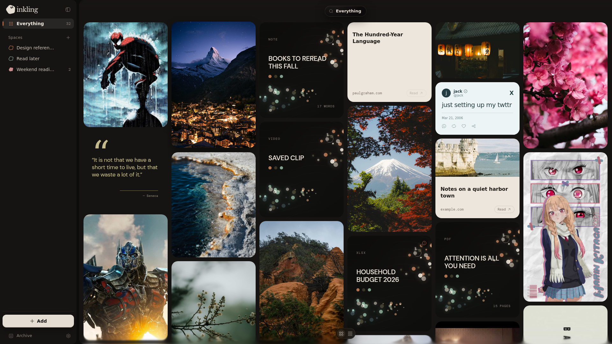
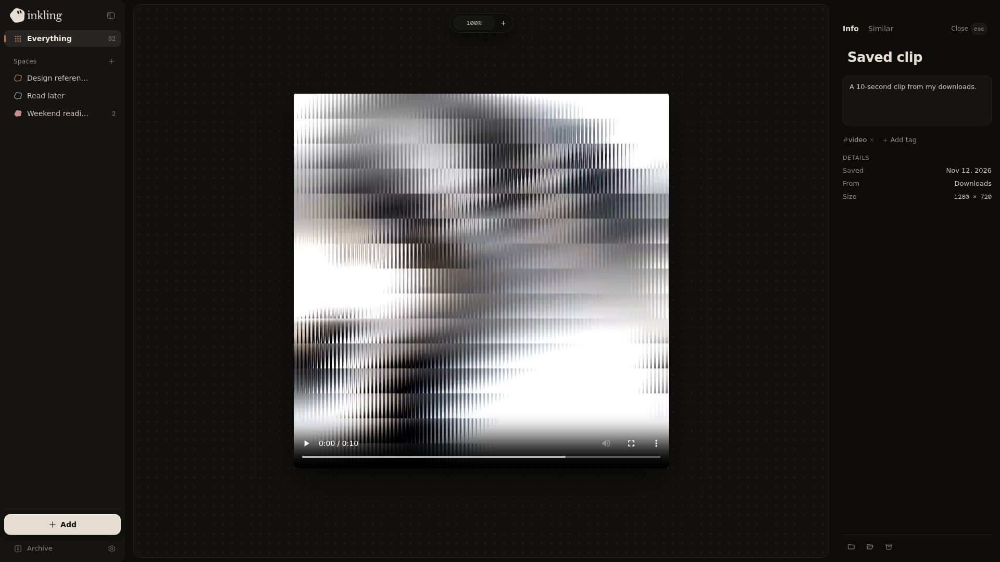

# inkling

### Save anything worth remembering. Find it later without organizing.

inkling is a private visual library for your desktop. Save articles, images, screenshots, PDFs, notes, quotes and video links in a couple of seconds, then find them again by describing them. There are no folders to keep and no tags to maintain. Search is the organizer.

<picture>
  <source media="(prefers-reduced-motion: reduce)" srcset="docs/assets/mascots/inkling-splash-still.svg">
  
</picture>



## What it does

**Saving is instant.** Paste a URL, drag in a file, paste from your clipboard, take a screenshot, or send a page from Chrome with the companion extension (not in the Chrome Web Store yet). The card appears at once. Text extraction, OCR and indexing run in the background while you keep working.

**Search understands what you describe.** It matches the words you type and what they mean, so `blue shoes` also finds a photo of sneakers that nobody captioned. It reads text out of images and scanned PDFs, so a screenshot of a recipe or a photo of a whiteboard is as searchable as a note you typed. It can also find images that look like another image.

**Everything looks like what it is.** Your library is a grid of thumbnails, not a list of details. Articles open in a clean reader, PDFs have page navigation, YouTube and Vimeo links play in place, and quotes keep where they came from. inkling also saves posts from X, local video files and plain files.



**Spaces gather related things.** A Smart Space is a saved search that updates as you save. Make one for `essay` and every new item that matches shows up in it. A regular Space holds the things you pick by hand.

**It's private.** Your library is a SQLite file and a folder of your files on your own disk, and you can export both together. There are no accounts, social features or analytics. inkling goes online only to fetch URLs you save, play videos and X posts you open, and, on Windows and Linux, check GitHub for an update at launch or when you ask (that check sends the app version, never library data). Everything else, search included, works offline.

## Meet the mascot

A small ink blot lives in the sidebar and pops into the search bar when you search. It drifts when idle, perks up when there's background work, and looks sad when a save fails. It's also the app icon.

<p>
  
  
  
  
</p>

## Status

Early development, but the core works: capture, search by words and meaning (including text inside images), the reader, video cards and Smart Spaces. Expect rough edges, and please file issues for the ones that bug you.

Next up: on-device summaries and concept extraction, an accessibility audit, and a signed macOS build that updates itself (the Apple silicon build does not yet). The [roadmap](docs/roadmap.md) has the checkbox-level status and [open bugs](docs/bugs.md) lists what is known to be broken.

## For developers

inkling runs on Windows, with `.deb` and AppImage builds for Debian and Ubuntu and a disk image for Apple silicon Macs. Install [Bun](https://bun.sh) at the version in `.bun-version`, clone this repo, then:

```powershell
bun install
bun run dev:app  # full desktop app
bun run dev      # browser-only preview of the UI with sample data
```

The Chrome extension lives in `extension/`; [extension/README.md](extension/README.md) covers loading and pairing it.

The stack is Electron, React, TypeScript, StyleX and Vite. A library process owns SQLite (FTS5) and the job queue, and a worker process runs Defuddle for articles, Tesseract for OCR, and local Nomic text and image embeddings through ONNX Runtime. [docs/tech-stack.md](docs/tech-stack.md) gives the reasons.

Start with [docs/README.md](docs/README.md), the index of project docs. [docs/operations/development.md](docs/operations/development.md) lists every command and check, and [CONTRIBUTING.md](CONTRIBUTING.md) says what contributions we take.

License: MIT
