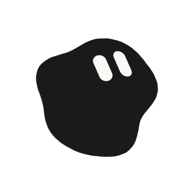
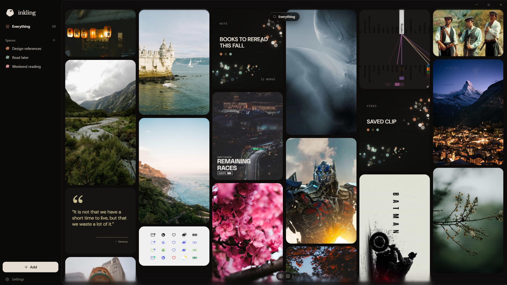
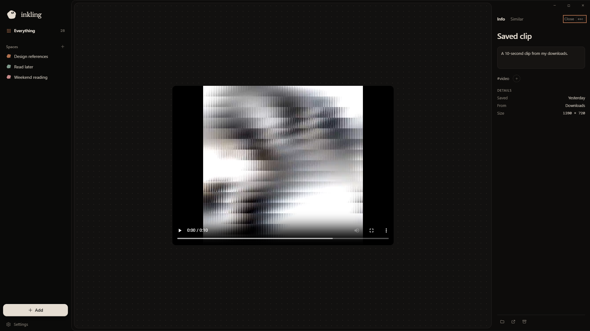
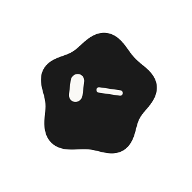
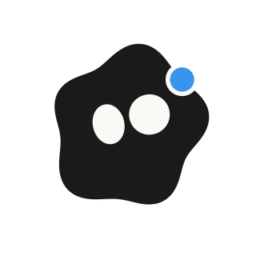

# inkling

### Save anything cool or worth remembering. Find it later without organizing.

inkling is a quiet little home for everything you want to keep: articles, images, screenshots, PDFs, notes, quotes, and video links. No folders to maintain, no manually tagging documents. You save something in a couple of seconds; inkling helps you find it again later.

Your library lives on your own computer. The app contacts GitHub only when you check for updates, and sends it no library data.





## Why you'll like it

**You don't have to micromanage it.** Like actually. Just save things and let it do its shit. The search is the organizer. inkling indexes what you saved in the background so you can find it later by describing it.

**It's visual.** Your library's displayed as a beautiful grid, not some ugly list of item details or some random, hastily made, scrapbook looking ideaboard. Articles, photos, PDFs, quotes, notes, videos, and posts each either show their contents in full or have their own custom little thumbnail made.

**It's private.** Your library is stored locally in SQLite on your computer, with your files in a folder beside it. No cloud account, feed, social features, or usage analytics. Update checks happen only when you ask and never send library data.


## Take the tour

### 1. Save in seconds

Paste a URL, drag in a file, paste from your clipboard, take a screenshot, or save from Chrome with the companion extension (not in the Chrome Web Store yet). inkling creates the card immediately and does the heavy lifting quietly in the background.



Supported media:

- URLs and articles (with a clean, readable copy extracted automatically)
- Images, screenshots, and PDFs (yes, even scanned ones)
- Quick notes and quotes with source attribution
- YouTube / Vimeo links and local video files
- Posts from X, plus files, clippings, and references

### 2. Find anything, even inside pictures

Search for any word including words *inside* your images and scanned documents. inkling reads text out of pictures (OCR) so a screenshot of a recipe, a photo of a whiteboard, or a scanned PDF is just as searchable as a note you typed.

It also understands meaning, not just exact words, and can find images that look similar to another image. Searches like `blue shoes` or `red honeycrisp apple` just work.

### 3. Browse, read, and rediscover

- **Visual library** — masonry grid with thumbnails generated automatically.
- **Distraction-free reader** — saved articles open with clean typography and styling, without ads or page clutter.
- **PDF viewer** — page navigation built in.
- **Video cards** — YouTube and Vimeo links get previews with click-to-play; uploaded videos play natively.
- **Quote cards** — save a quote with where it came from.
- **Smart Spaces** — Basically saved search queries, Spaces update themselves. Save a search once (say, `essay`) and new saves show up on their own.

### 4. Your stuff stays yours

- Local-first: database + assets on your disk, exportable together.
- Background processing: capture is instant; OCR, embeddings, and indexing happen while you look around.
- No social features, no cloud required, no AI-management chores. AI-derived helpers stay invisible. They just make search better.

## Meet the mascot

A small ink blot lives in the sidebar and pops into the search bar while you type. It drifts when idle, perks up when there's background work, and looks sad when a save fails. It's also the app icon.

<p>
  
  
  
  
</p>

## What's next

Little by little, inkling is growing toward:

- On-device summaries, automatic concept extraction, and structured analysis
- An accessibility audit and web-version portability
- Performance and refactoring work as the feature set settles
- Maybe macOS, if I can get money for a MacBook to test on. Linux already has `.deb` and AppImage builds.

See [the Roadmap](docs/roadmap.md) for the honest, checkbox-level status, and [open bugs](docs/bugs.md) for what is known to be broken.

## Status

Early development, but the core already works: capture, storage, search by words and meaning (including text inside images), thumbnails, the reader, video cards, and Smart Spaces. Expect rough edges and missing pieces and please file issues for the ones that bug you. I'm trying to make this into a product that you and I can use day-to-day.


## FAQ

**Do I need to file things into folders?**
Nope. Save it and move on. Smart Spaces collect items that match saved searches, and Regular Spaces let you curate collections by hand.

**Is my stuff uploaded somewhere?**
Nope. Processing and storage are local. inkling goes online to fetch URLs or remote media you choose to save, play videos you start, and check GitHub for an update when you ask it to. The update check shares the app version, not library data.

**What can I save?**
Articles, general web pages, images, screenshots, PDFs, notes, quotes, video links, X posts, and miscellaneous files.

**Does it work offline?**
Well no duh. Saving a fresh URL needs internet though, obviously.


## For developers

inkling runs on Windows, with `.deb` and AppImage builds for Debian and Ubuntu. Install [Bun](https://bun.sh) at the version in `.bun-version`, clone this repo, then:

```powershell
bun install
bun run dev:app  # full desktop app
bun run dev      # browser-only preview of the UI with sample data
```

The Chrome extension lives in `extension/`; [extension/README.md](extension/README.md) covers loading and pairing it.

The stack is Electron, React, TypeScript and Vite, with Node.js and SQLite (FTS5) in the main process, Defuddle for articles, Tesseract for OCR, and local Nomic text and image embeddings through ONNX Runtime. [docs/tech-stack.md](docs/tech-stack.md) gives the reasons.

Start with [docs/README.md](docs/README.md), the index of project docs. [docs/operations/development.md](docs/operations/development.md) lists every command and check, and [CONTRIBUTING.md](CONTRIBUTING.md) says what contributions we take.

License: MIT
